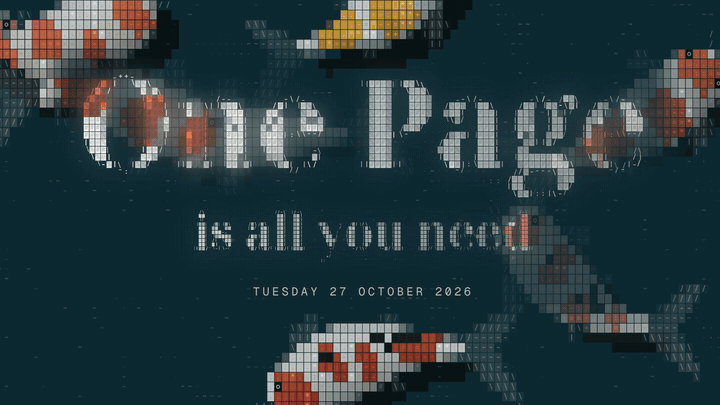

AI student at EPITA Paris. I build open-source tools with AI agents. My three current projects share one look: koi drawn in text characters, a black cat in character tiles, and black water.

> [!IMPORTANT]
> **Open to 2027 AI engineering internships and AI research roles (research intern or RA).** [LinkedIn](https://www.linkedin.com/in/haojie-song/) · [X](https://x.com/Song_Of_Hero) · [haojie.song@epita.fr](mailto:haojie.song@epita.fr) · [pursuer.master@gmail.com](mailto:pursuer.master@gmail.com)

### The ASCII Koi series: what I'm building now

<table>
<tr>
<td width="55%"></td>
<td><b><a href="https://github.com/pursurer/ascii-koi">ASCII Koi</a></b> Your new tab is a koi pond, under a clock made of the same characters. Click for the cat's paw, right-click to feed the koi. Its <code>pond.js</code> is the engine the other two run, byte for byte.  <a href="https://pursurer.github.io/ascii-koi/">Live pond</a> · <a href="https://github.com/pursurer/ascii-koi">Repo</a></td>
</tr>
<tr>
<td width="55%"></td>
<td><b><a href="https://github.com/pursurer/codex-koi">Codex Koi</a></b> The pond behind the Codex desktop app's new-chat page. Koi light up the heading as they swim under it, and the black cat stays with you as your Codex pet.   <a href="https://github.com/pursurer/codex-koi">Repo</a> · <a href="https://github.com/pursurer/codex-koi#the-black-cat">The black cat pet</a></td>
</tr>
<tr>
<td width="55%"></td>
<td><b><a href="https://github.com/pursurer/one-page-is-all-you-need">One Page is all you need</a></b> Every morning an n8n agent reads my seven sources and writes me one page: the five things that matter today, opening on the koi pond. Where the koi and the cat began.  <a href="https://pursurer.github.io/one-page-is-all-you-need/">Demo</a> · <a href="https://github.com/pursurer/one-page-is-all-you-need">Repo</a></td>
</tr>
</table>

Before the ASCII Koi series, I built paper tools (a [23,197-paper dataset](https://github.com/pursurer/top-ai-conference-papers), a scraper and a screening agent) and a Seedance video skill that ships in [awesome-seedance](https://github.com/LearnPrompt/awesome-seedance) (2.4k★); they are all in my [repositories](https://github.com/pursurer?tab=repositories).
