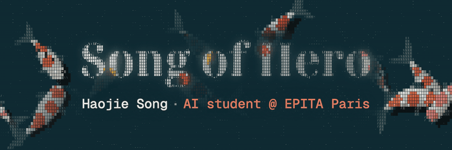
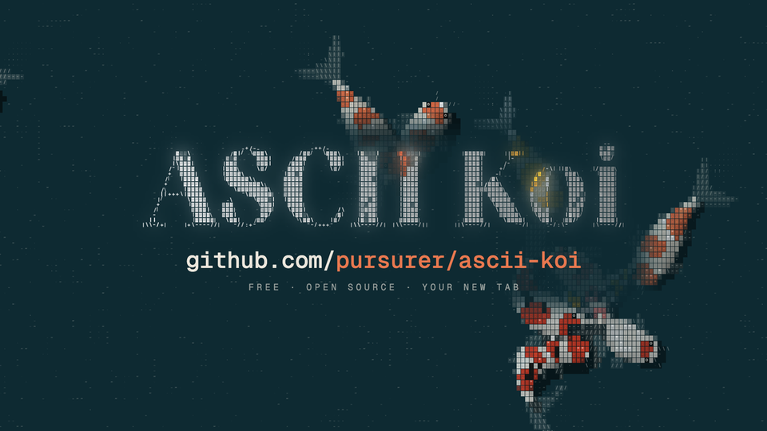
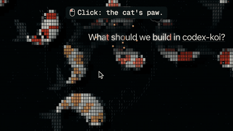

AI student at EPITA Paris. I build open-source tools with AI agents.

> [!IMPORTANT]
> **Open to 2027 AI engineering internships and AI research roles (research intern or RA).** [LinkedIn](https://www.linkedin.com/in/haojie-song/) · [X](https://x.com/Song_Of_Hero) · [haojie.song@epita.fr](mailto:haojie.song@epita.fr) · [pursuer.master@gmail.com](mailto:pursuer.master@gmail.com)

  
  
  

- **[One Page is all you need](https://github.com/pursurer/one-page-is-all-you-need)**: every morning an n8n agent reads my seven sources and writes me one page, the five things that matter today, each traced to its source. Where the koi and the cat began. [Demo](https://pursurer.github.io/one-page-is-all-you-need/)
- **[Seedance production workflow](https://github.com/pursurer/seedance-awesome-director)**: an Agent Skill for Codex and Claude Code that takes a Seedance video from brief to storyboard to shot-by-shot QA. It ships in [awesome-seedance](https://github.com/LearnPrompt/awesome-seedance) (2.4k★).
- **[ASCII Koi](https://github.com/pursurer/ascii-koi)**: your new tab is a koi pond, under a clock made of the same characters. Click for the cat's paw, right-click to feed the koi. Its `pond.js` is the engine the other two run, byte for byte. [Live pond](https://pursurer.github.io/ascii-koi/)
- **[Codex Koi](https://github.com/pursurer/codex-koi)**: the pond behind the Codex desktop app's new-chat page. Up to 24 koi light up the heading as they swim under it, and [the black cat](https://github.com/pursurer/codex-koi#the-black-cat) stays with you as your Codex pet.

Everything else is in my [repositories](https://github.com/pursurer?tab=repositories).
