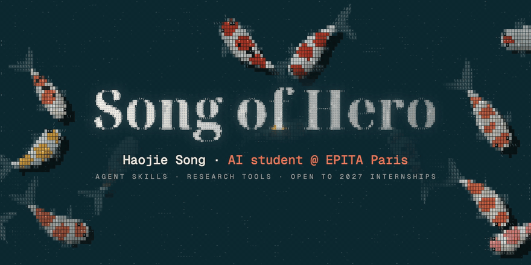

AI student at EPITA Paris. I build agent skills, research tools and things that move: my Seedance video skill for Codex and Claude Code ships in [awesome-seedance](https://github.com/LearnPrompt/awesome-seedance) (2.4k★), where I'm the only contributor besides the maintainer; my paper pipeline graded 10,000+ papers from 10 AI conferences; and [ASCII Koi](https://github.com/pursurer/ascii-koi), the pond above, turns your new tab into koi, ripples and a clock drawn entirely in text characters ([feed the live pond](https://pursurer.github.io/ascii-koi/)).

> [!IMPORTANT]
> **Open to 2027 AI engineering internships and AI research roles (research intern or RA).** [LinkedIn](https://www.linkedin.com/in/haojie-song/) · [X](https://x.com/Song_Of_Hero) · [haojie.song@epita.fr](mailto:haojie.song@epita.fr) · [pursuer.master@gmail.com](mailto:pursuer.master@gmail.com)

### The ASCII Koi family

Small things that share one look: koi drawn in text characters, a black cat in character tiles, and black water.

| Project | What it is |
|---|---|
| [ASCII Koi](https://github.com/pursurer/ascii-koi) | Your new tab is a koi pond, under a clock made of the same characters ([live pond](https://pursurer.github.io/ascii-koi/)) |
| [Codex Koi](https://github.com/pursurer/codex-koi) | The pond behind the Codex desktop app's new-chat page |
| [Claude Koi](https://github.com/pursurer/claude-koi) | The pond in a pane beside Claude Code: type `/koi` |
| [Codex ASCII Pets](https://github.com/pursurer/codex-ascii-pets) | The koi and the black cat as Codex pets |
| [One Page is all you need](https://github.com/pursurer/one-page-is-all-you-need) | Where the koi and the cat began: an n8n agent writes me one page every morning ([demo](https://pursurer.github.io/one-page-is-all-you-need/)) |
